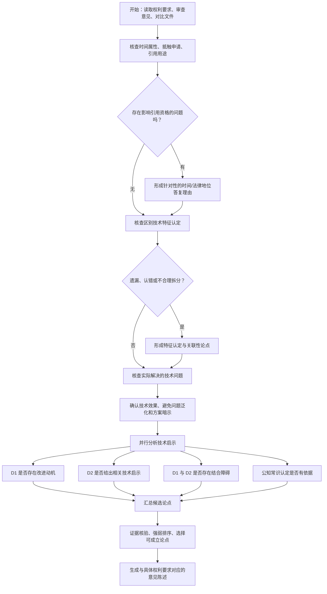

# 迈瑞 OA 答复策略决策树（图片转写与 Skill 规则化）

> 文件路径：`references/mairui_decision_tree.md`  
> 版本：v0.1（根据用户提供的一张照片整理，待人工校对）  
> 用途：辅助中国发明专利审查意见答复中的**创造性分析与争辩策略选择**。  
> 来源标识：`[原图]` = 照片可以支持的内容；`[整理]` = 为便于 Skill 执行而做的结构化表达；`[补充]` = 不在照片中、为防止误用而增加的操作要求。  
> 术语：D1＝对比文件1；D2＝对比文件2。涉及 D3 或更多文件时，重复分析其公开内容、技术启示及组合理由，**不是原图所写的专门分支**。

## 一、先看总决策表

| 编号 | 检查节点 | 原图主要提问 | 可能的答复方向 | 优先核实的证据 |
|---|---|---|---|---|
| P0 | 对比文件时间属性 | 对比文件的日期是否正确？特别注意抵触申请。 | 日期与对比文件适格性存在问题时，优先核查并针对性答复。 | 申请日、优先权日、公开日、被评价权利要求的有效申请日，以及通知书的引用用途。 |
| P1 | 区别技术特征认定 | 审查员是否认错、漏掉区别特征，或将关联特征不合理拆分？ | 重点纠正特征认定和拆分，强调特征之间的技术关联。 | 权利要求原文、D1 精确段落/附图、特征之间的依赖关系。 |
| P2 | 实际解决的技术问题 | 技术问题是否泛化？是否把技术方案写进技术问题？技术问题的发现本身是否有创造性？ | 重新客观表述问题，避免事后分析；有证据时讨论发现问题的非显而易见性。 | 区别特征的技术效果、说明书、D1 的背景与技术约束。 |
| P3 | D1 改进动机 | D1 是否有必要或可能朝本申请方向改进？ | 从已解决的问题、方案约束、改进与原有设计目的冲突等方向论证。 | D1 原始目的、整体工作原理、实施例与相应约束。 |
| P4 | D2 技术启示 | D2 是否公开区别特征？是否用于解决相同技术问题？ | 比较相应技术手段所起的作用、问题及使用场景，避免仅作字面匹配。 | D2 实施例、技术效果、适用条件；D1 与本申请场景。 |
| P5 | D1 与 D2 的结合障碍 | 两者构思是否相背离？把 D2 用到 D1 是否需要重大改造？ | 分析兼容性、结构/步骤/控制逻辑冲突，以及是否并非简单组合。 | D1 与 D2 具体实施方式、系统接口/约束和改造后影响。 |
| P6 | 公知常识认定 | 审查员援引的常规技术手段是否与区别特征或其解决的问题对应？ | 核查公知常识的证据、对应关系和技术作用；避免无证据的笼统断言。 | 通知书原话、可能的公知常识证据、具体技术效果。 |

**流程读法：** 原图先检查时间/抵触申请，再检查区别特征及技术问题，之后进入“技术启示”并行审查：P3、P4、P5、P6。后四项是**可并行使用的不同答复论点**，并非只能四选一。[整理]

## 二、原图策略逐项整理

### P0 — 日期与抵触申请

- [原图]「对比文件的日期是否正确（特别是存在抵触申请）」。
- [原图] 「若存在抵触申请，请针对性答复该点即可」。
- [整理] 先核查对比文件的时间与法律地位，再决定是否需要继续以该文件作为创造性判断的对比基础。
- [重要提示] **原图的“是/否”箭头与文字之间存在逻辑歧义**：图上“是”通向“若存在抵触申请……”，而“否”通向区别特征分析。Skill **不得**把“日期正确＝必然存在抵触申请”编码为规则。应将“日期核查”与“是否属于抵触申请”分为两项独立判断。
- [补充] 抵触申请通常属于新颖性判断问题，不得直接照搬为创造性评价的现有技术；必须依具体申请日、优先权、公开时间及引用方式核定。不能因为有抵触申请就无条件宣布审查意见不成立。

### P1 — 区别技术特征认定

- [原图] 「区别技术特征认定是否有误，着重看各个关联的技术特征是否被拆分为多个分割的特征进行论述」。
- [原图] 若认定有误 → 「请重点答复」。
- [整理] 对每个区别特征建立逐项证据映射，并检查一组特征是否形成共同作用机制。主张“应整体考虑”时，必须说明**具体的相互作用及共同技术效果**，不能仅因其属于同一权利要求就主张不可拆分。

### P2 — 技术问题是否准确

原图列出三项检查：

1. [原图] 「技术问题是否泛化、未落实具体的申请场景」。
2. [原图] 「技术问题是否包含技术特征所对应的技术方案？」
3. [原图] 「技术问题的发现是否具有创造性？」

[整理] 确定区别特征在本申请中的实际技术效果，并在此基础上表述客观的技术问题。技术问题不能预先暗示区别特征的具体解决方案。将“问题本身的非显而易见性”视为待论证事项，而不是自动成立的结论。

### P3 — 对比文件1是否存在改进动机

原图列出三个答复方向：

1. [原图] 「对比文件1采用了一个完全不同的方案解决了与区别技术特征相同的技术问题，可考虑改进动机」。**此句“可考虑改进动机”的正反指向不够明确，疑有原图措辞歧义；保留转写，不将其当作固定结论。**
2. [原图] 「对比文件1的方案限制不可能提出该技术问题」。
3. [原图] 「若对比文件1改进该技术问题，则与对比文件的初始申请动机相矛盾」。

[整理] 尝试论证 D1 已采用不同解决路径、没有提出该问题的客观需求，或者所设想的改造破坏 D1 重要的工作前提。**应分别寻找 D1 中可核查的依据；单纯“方案不同”不自动等于没有改进动机。**

### P4 — 对比文件2的区别技术特征与技术问题

- [原图] 「对比文件2是否公开区别特征与技术问题的关系」。
- [原图] 「对2是否公开区别技术特征，是否解决了相同的技术问题（着重考虑与本申请应用场景的差异）」。
- [整理] 对比 D2 中相关手段与本申请特征的**内容、作用、所解决的问题、应用条件**；若仅形式相同但作用不同，应解释具体差异以及为什么不导向本申请。

### P5 — D1 + D2 是否存在结合障碍

原图列出两个答复方向：

1. [原图] 「对2的实现手段与对1的构思相背离」。
2. [原图] 「对2的实现手段应用于对1需要在对1中进行较大改进，而不是简单结合」。

[整理] 识别 D1 的工作机制、D2 的必要前提及组合后冲突。**“需要改动”不足以单独证明非显而易见；要具体说明改动为何超过常规适配，或为什么本领域技术人员没有合理动机如此改造。**

### P6 — 常规技术手段／公知常识

原图列出三个答复方向：

1. [原图・个别字迹不够清楚] 「[疑似：详述／阐述]是否为发明点，发明点不能以公知常识进行评判」。此条按原图大意保留，**不是法律上的绝对规则**。
2. [原图] 「常规技术手段解决的技术问题，与区别技术特征解决的技术问题不同」。
3. [原图] 「解决该技术问题的常规技术手段与区别技术特征不同」。

[整理] 检查审查员所谓公知常识是否与**具体特征、技术作用、技术问题和技术效果**相匹配；对关系创造性判断的重要争议点，核查证据及说理。**不能以“属于发明点”为由断言技术特征必然不是公知常识**，也不能仅因技术术语不同就否定公知常识。

## 三、Skill 决策流程（规范化，不机械照搬原图歧义）



**说明：** 上图“形成一个论点后仍继续检查其他论点”、证据排序以及输出步骤属于 [整理／补充]，是为了让 Skill 能稳健执行；原图没有完整定义这些控制逻辑。

## 四、供 Skill 调用的执行规则

以下规则是**由原图归纳的操作指令**，不等同于原图逐字内容。

1. **必须先查事实，再形成答复观点。** 对权利要求、审查意见、D1/D2、说明书找到精确对应段落；没有证据则标记“待核实”。
2. 先判断时间和引用资格，再审查区别特征认定、实际解决的技术问题，最后并行分析改进动机、D2 技术启示、结合障碍、公知常识。
3. 若审查员错误地拆分了关联特征，应指出特征之间的输入/输出关系、时序关系、约束关系或协同作用及技术效果；禁止只写“有机整体”。
4. 若客观技术问题被泛化或写入解决方案，依据区别特征的可证实效果重新表述；不得编造说明书没有记载、亦不能从原申请推导出的技术效果。
5. 分析 D2 时，不止判断是否出现相同术语，还要判断相关技术手段在 D2 中的作用、解决的问题、前提条件及移植到 D1 后的效果。
6. 论证 D1 + D2 结合困难时，必须说明**哪一项结构、流程或工作原理**发生冲突，以及引用文件证据；不可空泛地说“无法结合”。
7. 审查员援引公知常识时，区分是否真正证明该技术手段为公知常识、是否能解决对应问题，以及是否可导向区别特征。不能仅凭“核心发明点”作否定判断。
8. 仅使用有证据、且能抵御审查员反驳的论点；对明显不成立的观点不要堆砌进正式意见陈述书。
9. 如果某一步缺少对比文件原文或有效权利要求文本，输出待核查项，不得捏造 D1/D2 披露段落。
10. 修改权利要求、审查修改超范围、援引法律规定等，不属于本图完整覆盖范围；应另调用相应 Skill 规则。

## 五、每个论点统一输出的结构化记录

```yaml
strategy_id: "P4"                         # P0-P6
question: "D2 的相关特征是否提供技术启示？"
conclusion: "成立 | 不成立 | 证据不足"
claim_features: ["需要分析的权利要求特征"]
examiner_position: "审查意见原文与页码"
evidence:
  application: ["本申请权利要求/说明书段落与原文"]
  D1: ["D1页码、段落、附图、原文"]
  D2: ["D2页码、段落、附图、原文"]
reasoning: "特征内容→实际作用→对应技术问题→技术启示/组合关系"
counterargument: "审查员可能如何继续反驳"
risk: "高 | 中 | 低"
priority: "主论点 | 辅助论点 | 不采用"
proposed_text: "可核验的答复论述草案，不编造依据"
```

## 六、原图不能直接视为法定审查规则的地方

- **时间节点歧义：** “日期是否正确”的“是/否”箭头逻辑不清；按两个独立事实核查而非硬编码原图分支。
- **D1 改进动机第 1 条：** “可考虑改进动机”正反含义不明；需核验原资料及结合实际案例解释。
- **公知常识第 1 条：** 图片首几个字不完全可辨，且“发明点不能以公知常识进行评判”不可作为绝对法律规则。
- **分析覆盖范围：** 图主要聚焦创造性争辩，未形成新颖性、清楚性、支持性、充分公开、修改超范围、单一性等全面答复 SOP。
- **画像上的手写勾画：** 勾、圈仅视为个人标记，不视为已验证的策略优先级或法律结论。

## 七、推荐在 SKILL.md 中这样引用

```markdown
### 创造性审通答复策略

在完成权利要求/审查意见/D1-Dn 的事实核验后，读取
`references/mairui_decision_tree.md`。

按 P0→P1→P2→（P3/P4/P5/P6 并行）的顺序逐项检测；
对各论点填写第五节结构化记录；只采用证据充分的论点。
该参考文件中的[原图]内容是经验策略，不得替代适用法律、
审查指南和案卷证据；遇到原图歧义按第六节处理。
```
